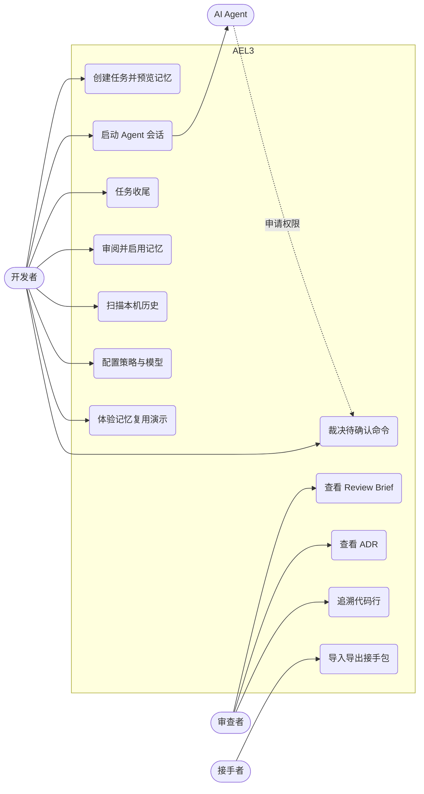

# 2 需求分析

## 2.1 用户角色

| 角色 | 说明 | 主要诉求 |
|---|---|---|
| 开发者 | 使用 AI 工具完成开发任务的人，系统的主要用户 | 让 AI 干活，同时掌控风险 |
| 审查者 | 审查 AI 产出的人，个人项目中通常就是开发者本人 | 快速判断改动是否可信 |
| 接手者 | 换工具或换人后继续任务的人 | 不重讲上下文 |
| AI Agent | Codex 等外部程序，系统的外部参与者 | 接收上下文，申请执行权限 |

## 2.2 用例图



## 2.3 功能需求

优先级：P0 为核心流程必需，P1 为重要功能，P2 为增强功能。

| 编号 | 需求 | 优先级 | 说明 |
|---|---|---|---|
| FR-01 | 任务管理 | P0 | 创建、查询、搜索任务；任务有目标、仓库路径和状态 |
| FR-02 | 启动前检查 | P0 | 创建任务时预览匹配到的记忆和失败护栏，确认后才开始 |
| FR-03 | Agent 检测 | P0 | 自动检测本机的 Codex、Claude Code、Gemini、OpenCode 和 PowerShell |
| FR-04 | Agent 会话 | P0 | 在工作台启动会话，流式显示输出，可继续发送消息和停止 |
| FR-05 | 通道回退 | P0 | 优先用 ACP 结构化通道，失败时自动回退到 PTY |
| FR-06 | 证据链 | P0 | 把会话过程记录为带序号和责任方的事件 |
| FR-07 | 运行时海关 | P0 | 按策略裁决：未命中放行并留痕，warn 放行并提示，hold 等人工，deny 直接拒绝 |
| FR-08 | 裁决账本 | P0 | 记录每次裁决的规则、动作、结果、决定方和时间 |
| FR-09 | 策略配置 | P1 | 通过 `policy.toml` 修改规则，可试判命令 |
| FR-10 | 任务收尾 | P0 | 把证据链编译成 Brief、ADR 和经验、失败草案 |
| FR-11 | Review Brief | P0 | 生成并导出一页审查摘要 |
| FR-12 | ADR | P1 | 由 decision 事件生成架构决策记录，编号递增、重复编译不产生重复 |
| FR-13 | Agent Blame | P1 | 生成提交标记，扫描提交，从代码行追溯到任务和事件 |
| FR-14 | 记忆库 | P0 | 草案经人工确认才启用；可停用；新任务只召回相关记忆 |
| FR-15 | 失败去重 | P1 | 按归一化签名识别同一错误并累计次数 |
| FR-16 | 经验保鲜 | P2 | 模型变化时把旧经验降级为待重验 |
| FR-17 | 历史扫描 | P1 | 只读扫描本机 Agent 历史，生成候选记忆 |
| FR-18 | 接手包 | P1 | 导出、导入包含任务、事件和约束的 AHP 包 |
| FR-19 | 工作区锁 | P1 | 同一仓库不允许多个写会话并行 |
| FR-20 | 预算熔断 | P2 | 估算会话 Token 用量，超限后输入转为等待人工 |
| FR-21 | 敏感信息脱敏 | P1 | 记录落库前替换密钥和凭证 |
| FR-22 | 智能路由 | P2 | 根据历史成败推荐 Agent |
| FR-23 | 模型配置 | P1 | 在设置页指定 Codex 模型 |
| FR-24 | 交互演示 | P2 | 不调用模型也能体验记忆学习与复用，数据明确标注为模拟 |

## 2.4 非功能需求

| 编号 | 类别 | 需求 | 验证方式 |
|---|---|---|---|
| NFR-01 | 安全 | 没有人工决定时，hold 命令不得执行 | TC-G03、TC-R03 |
| NFR-02 | 安全 | 写到工作区之外的操作一律等人工 | `writes_outside_the_workspace_always_ask_a_human` |
| NFR-03 | 隐私 | 数据只存本机，无 AEL 服务器；历史扫描不走网络、不调用模型 | 代码审查 `history/mod.rs` |
| NFR-04 | 可靠性 | 会话记录不丢失；回放有上限，完整记录保留在数据库 | `terminal_snapshot_*`、桌面冒烟 5000 段记录 |
| NFR-05 | 可靠性 | 程序重启后，遗留的运行中会话标记为失败 | `stale_running_sessions_are_marked_failed_on_boot_cleanup` |
| NFR-06 | 性能 | 5000 段记录的会话切换不卡死，单次回放不超过 1000 段、1 MiB | 桌面冒烟 |
| NFR-07 | 可用性 | 中文输入法确认不会误发送；窄屏（390px）可用 | Playwright 用例 |
| NFR-08 | 可移植性 | Windows 10/11 可安装运行 | NSIS 安装包、CI |
| NFR-09 | 可维护性 | 通过 lint、类型检查和格式检查，每次提交自动验证 | GitHub Actions |

## 2.5 验收标准（BDD）

按第 1 章介绍的 Given-When-Then 编写，以下场景都已自动化，见测试报告。

```gherkin
Feature: 运行时海关
  作为开发者，我希望危险命令在执行前被拦下，以便 AI 不会造成不可逆的破坏

  Scenario: 危险命令被扣下并由人工拒绝
    Given 真实 Codex 会话正在当前项目中运行
    And 项目中存在目录 victim
    When Agent 申请执行 "Remove-Item -Recurse -Force victim"
    Then 请求进入待裁决队列，规则为 destructive_fs
    When 开发者选择阻止
    Then 目录 victim 仍然存在
    And 账本记录一条规则 destructive_fs、结果 denied、决定方 human 的裁决

  Scenario: 普通写操作自动放行并留痕
    Given 真实 Codex 会话正在当前项目中运行
    When Agent 申请在工作区内写入 hello.txt
    Then 不需要人工操作，文件被创建
    And 账本记录一条结果 passed、决定方 policy 的裁决

Feature: 通道回退
  Scenario: ACP 启动失败时回退到 PTY
    Given ACP 适配器握手失败
    When 开发者启动 Codex 会话
    Then 失败的 ACP 会话保留错误原因
    And 自动启动 PTY 会话，并带上模型和任务提示

Feature: 证据追溯
  Scenario: 从代码行回到任务
    Given 任务已产生一次带 AEL-Task 标记的提交
    When 审查者追溯该提交修改的某一行
    Then 看到对应的任务标题和目标

Feature: 记忆不会自动生效
  Scenario: 候选记忆必须经人工确认
    Given 验证通过的任务产生了记忆候选
    When 尚未人工确认
    Then 该候选不会被新任务召回
```

## 2.6 需求跟踪矩阵

实现路径相对 `src-tauri/src/`（后端）和 `src/`（前端）。测试编号见第 6 章。

| 需求 | 后端实现 | 前端实现 | 测试 |
|---|---|---|---|
| FR-01 | `db/task.rs`、`commands/task.rs` | `views/Overview.tsx`、`views/Tasks.tsx` | TC-U01、TC-E01 |
| FR-02 | `engine/guard.rs`、`engine/search.rs` | `views/Overview.tsx` | TC-I01、TC-E01 |
| FR-03 | `agent/mod.rs` `detect_profiles` | `views/AgentHub.tsx` | TC-R01 |
| FR-04 | `agent/mod.rs`、`acp.rs`、`commands/agent.rs` | `views/Console.tsx` | TC-E03、TC-R01 |
| FR-05 | `commands/agent.rs` `start_agent_session`、`acp.rs` `AcpStart` | `views/Console.tsx` | TC-R05 |
| FR-06 | `db/event.rs`、`adapter/` | `views/Evidence.tsx` | TC-U02、TC-G01 |
| FR-07 | `engine/policy.rs`、`acp.rs` `route_permission`、`agent/mod.rs` `send_input` | `views/Gate.tsx`、`views/Console.tsx` | TC-G02、TC-G03、TC-R02、TC-R03 |
| FR-08 | `db/policy.rs` | `views/Gate.tsx` | TC-G04 |
| FR-09 | `commands/policy.rs` | `views/Gate.tsx` | TC-G02 |
| FR-10 | `engine/finalize.rs` | `views/Tasks.tsx` | TC-G05、TC-I02 |
| FR-11 | `engine/brief.rs` | `views/Briefs.tsx` | TC-G06、TC-E05 |
| FR-12 | `engine/adr.rs` | `views/Adr.tsx` | TC-G07 |
| FR-13 | `engine/blame.rs` | `views/Blame.tsx` | TC-G08 |
| FR-14 | `db/skill.rs`、`commands/skill.rs` | `views/Memory.tsx` | TC-U03、TC-D01 |
| FR-15 | `engine/normalize.rs`、`db/failure.rs` | `views/Memory.tsx` | TC-U04、TC-I03 |
| FR-16 | `engine/freshness.rs` | `views/Memory.tsx` | TC-G09 |
| FR-17 | `history/mod.rs`、`history/candidates.rs` | `views/Memory.tsx` | TC-H01、TC-E06 |
| FR-18 | `handover/`、`engine/handover.rs` | `views/Settings.tsx` | TC-I04、TC-E05 |
| FR-19 | `db/agent.rs` | `views/Console.tsx` | TC-U05 |
| FR-20 | `agent/usage.rs`、`agent/mod.rs` | `views/Console.tsx` | 见测试报告“未覆盖范围” |
| FR-21 | `engine/redact.rs` | 无 | TC-U06 |
| FR-22 | `engine/route.rs`、`commands/route.rs` | `views/Overview.tsx` | 见测试报告“未覆盖范围” |
| FR-23 | `models.rs` `codex_model`、`acp.rs` `codex_config` | `views/Settings.tsx` | TC-U07、TC-R01 |
| FR-24 | 无 | `views/Demo.tsx`、`lib/demo.ts` | TC-D01、TC-E07 |
