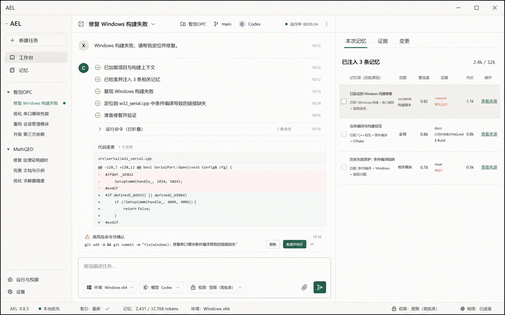
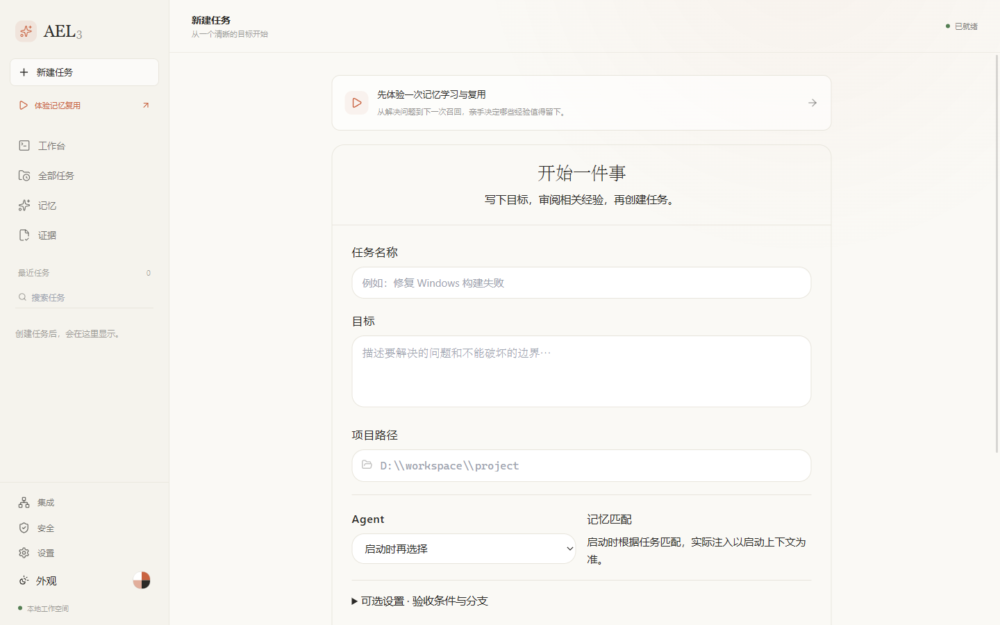
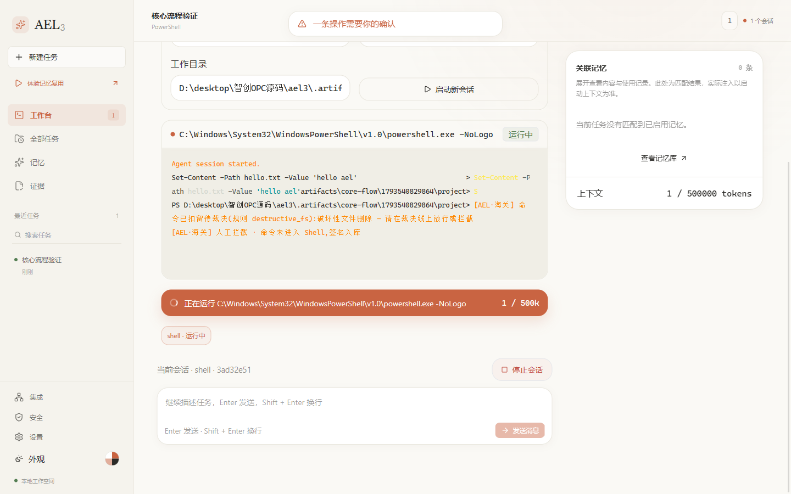
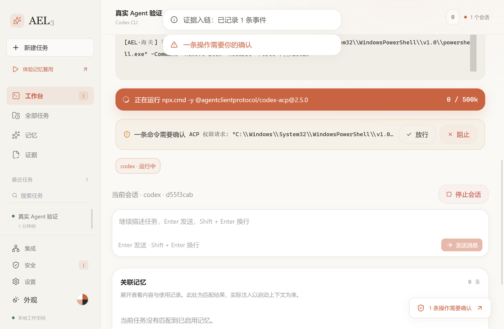
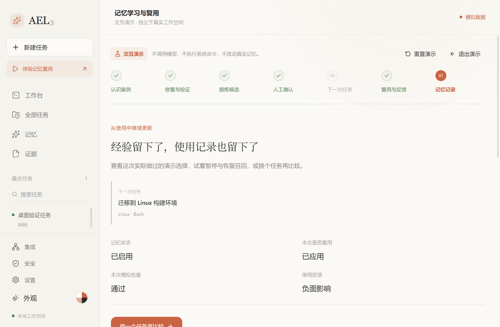
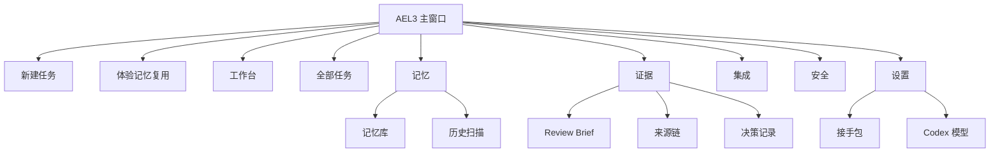
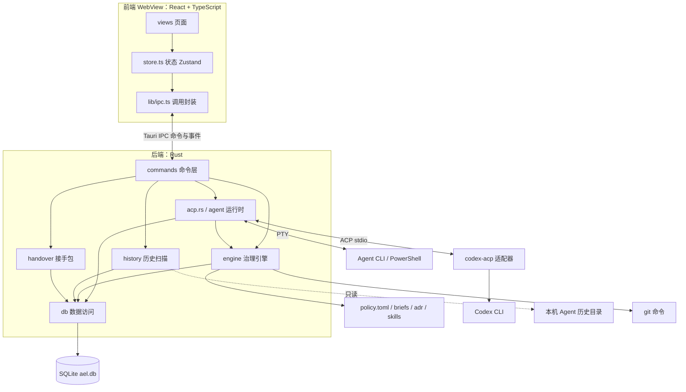
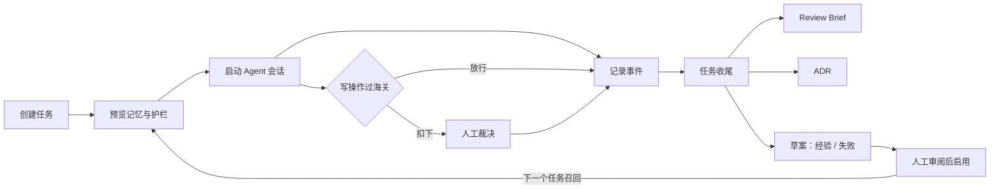
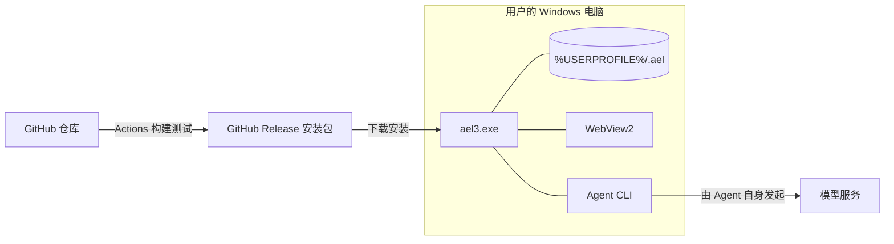

# 3 原型设计与概要设计

## 3.1 原型设计

原型分两轮。先用 `design/mockups/` 中的高保真设计稿确定信息结构和视觉方向，再在实现中按实际使用流程简化：早期有十个并列页面，后来收敛为工作台、任务、记忆、证据四个主入口，集成、安全和设置放在侧边栏底部。

设计稿：

实际界面（均为真实程序截图）：

| 页面 | 作用 | 截图 |
|---|---|---|
| 新建任务 | 从目标开始，创建前预览记忆和护栏 |  |
| 工作台 | 运行 Agent、查看输出、裁决命令 |  |
| 海关裁决 | 真实 Codex 申请删除目录时被扣下 |  |
| 记忆复用演示 | 不调用模型的交互演示 |  |

页面结构：

视觉上采用暖纸色画布和单一珊瑚橙强调色，危险操作用醒目的确认条，不用弹窗打断。规范见 `design/DESIGN.md`。

## 3.2 总体架构

系统是 Tauri 2 桌面应用，采用**前后端分层 + 本地存储**的单体架构。团队只有一人、用户在本机，没有多用户并发需求，微服务只会增加复杂度。

分层规则：

- `commands` 只做参数转换和调度，不写业务逻辑。
- `engine` 放治理规则。其中策略判定和脱敏是纯逻辑，便于单元测试。
- `db` 独占 SQL，其他模块不直接写 SQL。
- 前端只通过 `lib/ipc.ts` 访问后端。在浏览器中运行时切换到 `lib/mock.ts`，所以界面可以脱离桌面环境测试。

## 3.3 技术选型

| 选择 | 理由 | 放弃的方案 |
|---|---|---|
| Tauri 2 | 安装包小（NSIS 约 5 MB），Rust 后端适合管理进程和 PTY | Electron：体积大 |
| Rust | 进程、并发和文件操作可靠，类型系统减少运行时错误 | Node 后端：长时间管理子进程的稳定性较弱 |
| SQLite + FTS5 | 单文件、零部署，支持全文检索 | 服务端数据库：与本地优先目标矛盾 |
| React 19 + TypeScript + Zustand | 生态成熟，类型与后端模型逐字段对齐 | 无 |
| xterm.js | 真实终端渲染，支持 PTY 输出 | 自绘文本框：无法显示 TUI |
| ACP 协议 | 能拿到结构化的消息、工具调用和权限请求，是海关介入的关键 | 只用 PTY：无法裁决 Agent 内部命令 |
| Cargo + pnpm | 依赖有锁文件，构建可复现 | 无 |

## 3.4 模块划分

| 模块 | 目录 | 职责 |
|---|---|---|
| 命令层 | `src-tauri/src/commands/` | 80 个 IPC 命令 |
| ACP 运行时 | `src-tauri/src/acp.rs` | 结构化会话、权限请求路由 |
| PTY 运行时 | `src-tauri/src/agent/` | 进程管理、输入裁决、预算、启动上下文 |
| 治理引擎 | `src-tauri/src/engine/` | 策略、脱敏、Brief、ADR、Blame、收尾、检索、路由、保鲜 |
| 适配器 | `src-tauri/src/adapter/` | 把不同 Agent 的输出归类成事件 |
| 历史 | `src-tauri/src/history/` | 只读扫描、候选提炼、质量门 |
| 接手包 | `src-tauri/src/handover/` | AHP 打包与解包 |
| 数据层 | `src-tauri/src/db/` | 建库、迁移、各实体读写 |
| 页面 | `src/views/` | 9 个主视图及证据子页 |
| 组件与库 | `src/components/`、`src/lib/`、`vendor/open-claude-ui/` | 通用组件、调用封装、演示状态机 |

## 3.5 核心业务流程

这个闭环就是产品的核心：经验从证据中来，经人工确认后服务下一个任务。

## 3.6 部署设计

AEL3 自身不访问模型服务，网络请求由各 Agent 工具自己发起（首次使用 ACP 时 `npx` 需要下载适配器）。

## 3.7 开发过程与软件工程方法

| 课程内容 | 本项目的做法 |
|---|---|
| 迭代开发（第 1 章） | 1.0 经验层 → 2.0 治理层 → 3.0 跨 Agent，每轮交付可运行版本 |
| V 模型（第 1 章） | 需求对应验收测试，设计对应集成测试，编码对应单元测试，见第 6 章 |
| BDD（第 1 章） | 需求分析用 Given-When-Then 写验收标准 |
| 构建脚本即代码（第 5 章） | `package.json`、`Cargo.toml`、`ci.yml` 都纳入版本控制 |
| 文档即代码（第 5 章） | 本报告用 Markdown 写，存放在 `docs/report/`，随代码提交 |
| 语义化版本（第 5 章） | 按 MAJOR.MINOR.PATCH 发布；ACP 适配器锁定精确版本，不用 `@latest` |
| CI（第 5 章） | GitHub Actions 每次提交自动运行 lint、类型检查、构建和测试 |
| 依赖治理（第 5 章） | Dependabot 每月检查依赖更新 |
| 代码审查（第 5 章） | 静态分析：ESLint、Clippy、rustfmt；个人项目没有同伴，AI 审查和自检是人工审查的替代，这是局限 |
| AI 辅助开发（第 1、5 章） | 使用 Claude Code、Codex 辅助编码、调试和写文档；开发者负责决策、验收和最终责任 |
