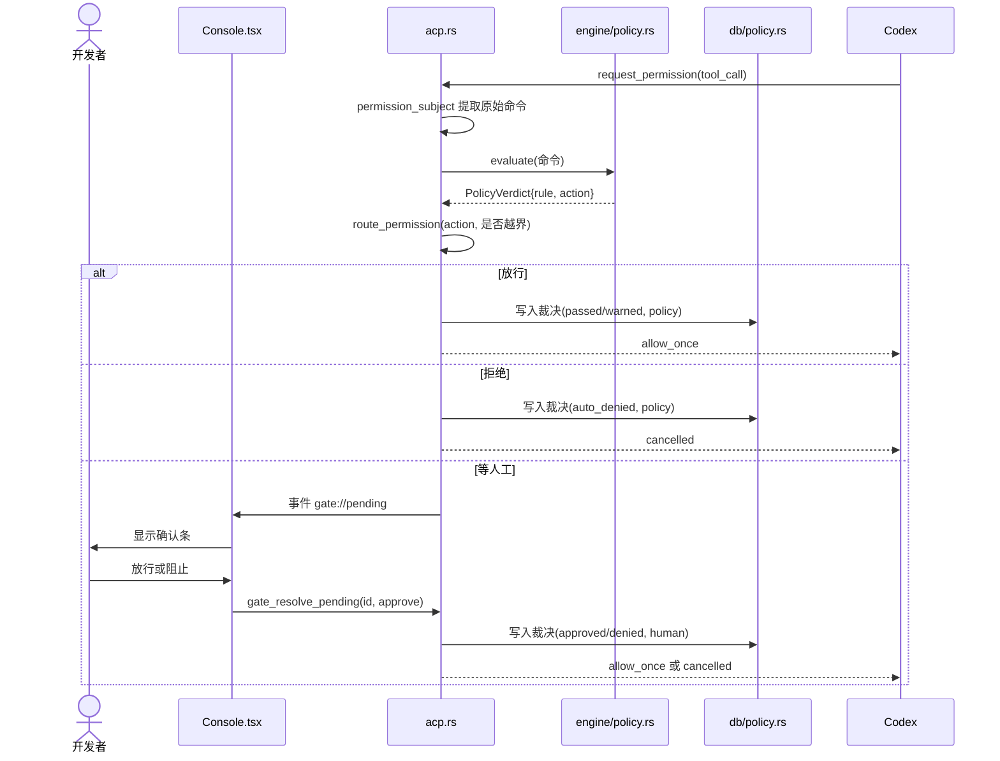
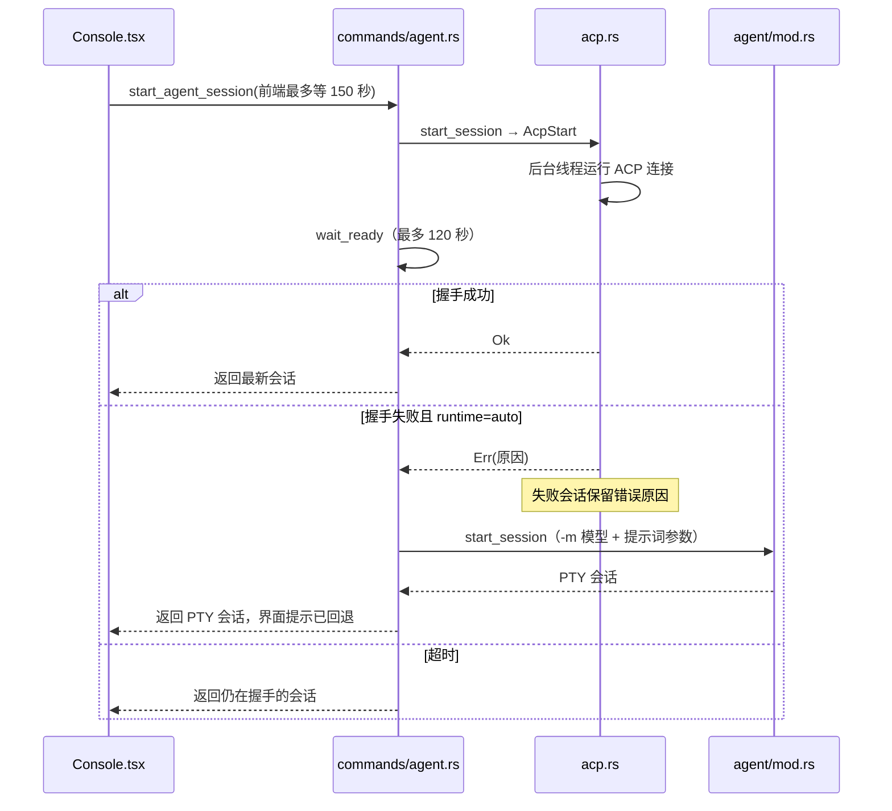
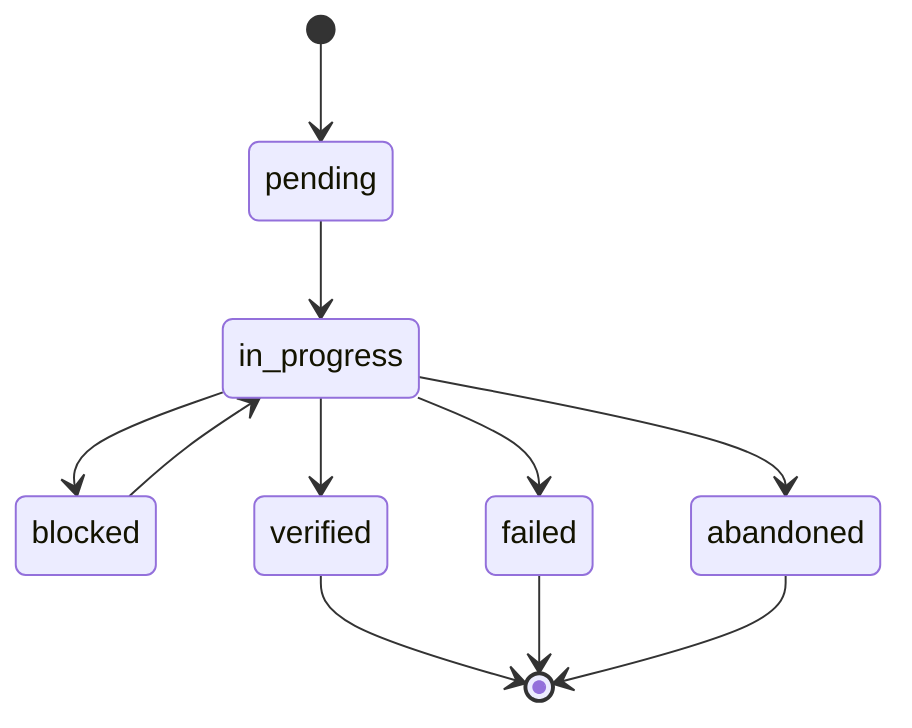
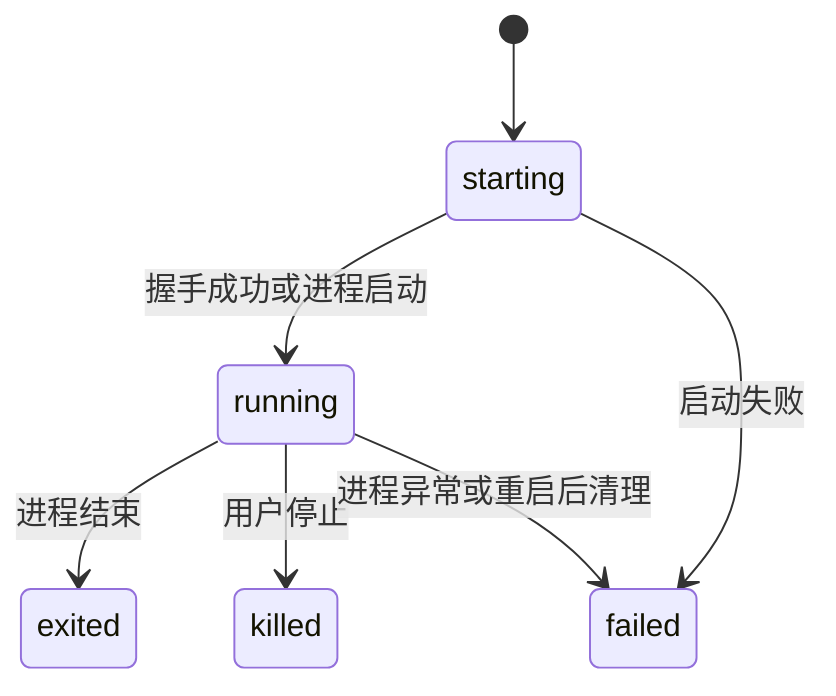
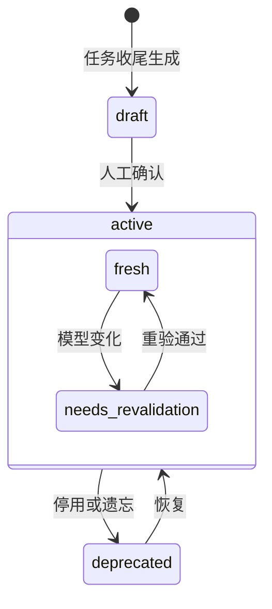
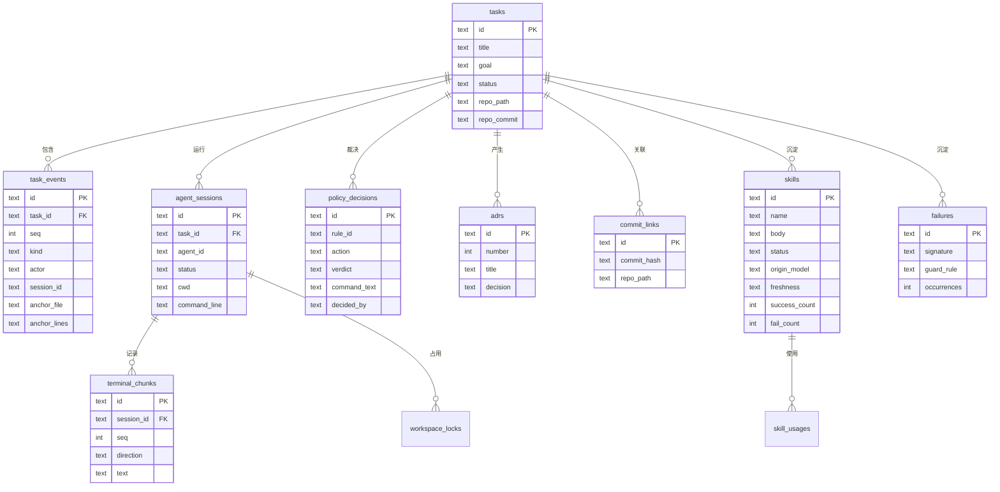

# 4 详细设计

## 4.1 运行时海关

海关是系统的核心，也是最容易出错的部分。它有两个入口。

### 策略模型

规则定义在 `~/.ael/policy.toml`（默认值 `contracts/policy-default.toml`），由 `engine/policy.rs` 编译成正则。多条规则同时命中时取最严处置：`deny > hold > warn > allow`。

| 规则 | 处置 | 含义 |
|---|---|---|
| `destructive_fs` | hold | 破坏性文件删除，如 `rm -rf`、`Remove-Item -Recurse -Force` |
| `secret_egress` | hold | 密钥出站 |
| `destructive_db` | hold | 高危数据库操作 |
| `destructive_git` | hold | 危险的 Git 操作 |
| `system_danger` | hold | 系统级危险操作 |
| `risky_git` | warn | 有损的 Git 操作 |
| `outbound_publish` | warn | 对外发布 |

### 权限路由（ACP 通道）

`acp.rs` 的 `route_permission` 是一个纯函数，可以穷举测试：

| 策略结果 | 工作区内 | 工作区外 |
|---|---|---|
| allow（未命中） | 自动放行，留痕 | 等人工 |
| warn | 自动放行，留痕 | 等人工 |
| hold | 等人工 | 等人工 |
| deny | 拒绝 | 拒绝 |

规则只看命令文本，看不出路径是否越界，所以工作区外的写入单独判断（`touches_outside_workspace`）。

**关键设计：** Codex 适配器默认的 auto-review 模式由模型自行批准命令，AEL 收不到任何请求。因此 AEL 以 `INITIAL_AGENT_MODE=read-only` 启动 Codex，让写操作和不能证明只读的命令都必须申请权限，再由 AEL 按上表裁决。普通操作自动放行，所以不会频繁打断用户。这个设计来自真实测试中发现的缺陷（测试报告 D-06）。



没有人工决定时，请求一直等待，**绝不自动放行**（NFR-01）。自动放行只选 `allow_once`，不选“总是允许”，避免一次放行扩大成长期授权（`allow_option`）。

### 输入裁决（PTY 通道）

`agent/mod.rs` 的 `send_input` 把用户输入按行缓冲，回车时判定整行：hold 的命令在 `hold_timeout_secs`（默认 120 秒）内未处理则默认拦截。启动上下文走 raw 通道不过海关，否则提示词里的示例命令会被误扣；Shell 会话不注入启动上下文。

**边界：** PTY 通道只能裁决从 AEL 输入的内容，Agent 在自身进程内执行的命令看不到。这是 ACP 成为首选通道的原因。

## 4.2 会话启动与回退



`start_agent_session` 是异步命令，握手期间不阻塞窗口主线程。

启动参数由纯函数 `spawn_args` 组装，便于测试：

- `CODEX_PATH`：优先用本机已登录的 CLI，而不是适配器自带的平台包。
- `INITIAL_AGENT_MODE=read-only`：见 4.1。
- `CODEX_CONFIG`：模型和推理强度，来自设置页。
- 适配器版本锁定（`codex-acp@2.5.0`），保证可复现。

## 4.3 状态设计

任务状态（`tasks.status`）。下图是正常路径；`update_task_status` 不强制转换顺序，只在进入终态（`verified`、`failed`、`abandoned`）时写入 `closed_at`。只有 `verified` 的任务收尾时才会生成经验草案（`engine/finalize.rs`）。



会话状态（`agent_sessions.status`）。`waiting`、`blocked` 在 schema 中预留，当前运行时不写入；等待裁决时会话保持 `running`。



记忆状态（`skills.status` 与 `skills.freshness`）：



只有 `active` 的记忆才会被召回；停用后历史来源仍保留，可以恢复。

## 4.4 数据设计

共 6 次版本迁移（`SCHEMA_VERSION = 6`，`contracts/migrations/`）。核心实体：



其他表：`agent_profiles`、`providers`、`mcp_servers`、`history_scan_runs`、`history_conversations`、`history_messages`、`skill_candidates`、`failure_candidates`、`schema_meta`，以及 FTS5 全文索引 `skills_fts`、`failures_fts`、`history_fts`。完整定义见 `contracts/schema.sql`。

设计要点：

- `task_events` 的 `(task_id, seq)` 唯一，保证证据链有序。
- `actor` 取 `ai`、`human`、`guard`、`system`，把每条证据的责任分清。
- `anchor_file`、`anchor_lines` 把事件锚定到代码行，供 Blame 使用。
- `policy_decisions.verdict` 取 `passed`、`warned`、`approved`、`denied`、`auto_denied`。

## 4.5 接口设计

前后端通过 80 个 Tauri 命令通信，完整清单见 `contracts/ipc-commands.md`、`contracts/agent-commands.md`。关键接口：

| 命令 | 参数 | 返回 | 说明 |
|---|---|---|---|
| `start_agent_session` | taskId, profileId, cwd, initialPrompt, runtime | AgentSession | 握手失败时回退 PTY |
| `send_agent_input` | sessionId, text | 无 | PTY 经海关；ACP 作为消息提交 |
| `gate_list_pending` | 无 | PendingCommand[] | PTY 与 ACP 合并的待裁决队列 |
| `gate_resolve_pending` | pendingId, approve | PolicyDecision | 人工裁决 |
| `gate_test_command` | 命令 | PolicyVerdict | 试判命令 |
| `finalize_task` | id | FinalizeResult | 编译 Brief、ADR 和草案 |
| `compile_brief` | taskId | ReviewBrief | 生成摘要 |
| `blame_line` | repoPath, file, line | BlameReport | 追溯代码行 |

后端向前端推送的事件：`agent://terminal-chunk`、`agent://session-status`、`agent://parsed-event`、`gate://pending`、`gate://decision`、`gate://budget`。

前端的调用超时默认 30 秒，`start_agent_session` 单独放宽到 150 秒，大于后端 120 秒的握手上限。

## 4.6 关键算法

### 错误签名（`engine/normalize.rs`）

目标是让同一个错误第二次出现时一定命中。按顺序把易变内容替换成占位符：时间戳 → UUID → 长哈希 → 内存地址 → 路径 → 行号 → 引号内的值 → 数字，然后转小写、合并空白，最后取 SHA-1。

```text
原文：  Error at C:\a\b.rs:10:5 at 2026-01-01T00:00:00Z
归一化：error at <path><loc> at <ts>（示意）
签名：  sha1(归一化文本)
```

### 记忆召回评分（`engine/search.rs`）

```text
score = 0.45 × 标签 Jaccard + 0.35 × 归一化 BM25 + 0.20 × 签名命中(0/1)
```

低于 `guardMinScore`（默认 0.35）的结果不注入。这是有意的取舍：拉错经验比不拉更糟。

### 提交追溯（`engine/blame.rs`）

1. 提交信息带 `AEL-Task: <任务 id>`。
2. `scan_repo_commits` 扫描最近 500 个提交，解析标记，写入 `commit_links`。
3. `blame_line` 用 `git blame` 找到某行的提交，查出任务，把锚定到该文件的事件排在前面返回。

### Brief 风险识别（`engine/brief.rs`）

自动生成风险项：没有验证记录、有错误未修复、人工放行过高危命令、证据链为空。

### 脱敏（`engine/redact.rs`）

落库前按“私钥块 → 特定前缀密钥 → 通用键值和 URL 内嵌密码”的顺序替换为 `<REDACTED:类型>`，先处理具体模式，避免被通用规则抢先匹配。

## 4.7 前端关键设计

| 问题 | 设计 | 代码 |
|---|---|---|
| 大量输出卡死界面 | 分批写入，尊重 xterm 背压，超限折叠并提示 | `lib/terminalWriter.ts` |
| 切换任务后晚到的响应覆盖当前内容 | 每次切换递增序号，返回时比对 | `views/Console.tsx`、`views/Tasks.tsx` |
| 中文输入法回车误发送 | 区分组合输入状态 | `vendor/open-claude-ui/src/useComposerImeGuard.ts` |
| 单页崩溃拖垮整个窗口 | 错误边界，可返回首页 | `components/ErrorBoundary.tsx` |
| 脱离桌面环境测试界面 | IPC 层在浏览器中切换到 mock | `lib/ipc.ts`、`lib/mock.ts` |
| 演示不污染真实数据 | 纯状态机，只存内存，导出带 `simulation: true` | `lib/demo.ts`、`lib/demo-session.ts` |
