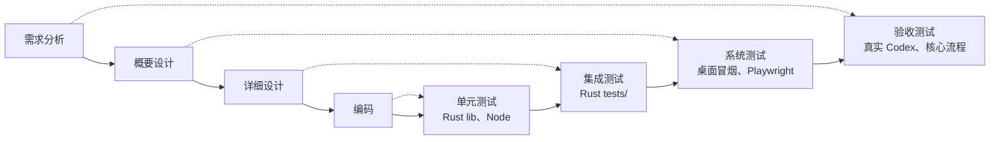

# 6 测试计划与测试用例

## 6.1 测试目标

1. 验证第 2 章的功能需求和非功能需求。
2. 重点保证 NFR-01：没有人工决定时，危险命令不得执行。
3. 不只验证模拟环境，要在真实桌面程序和真实 Agent 上验证核心流程。

## 6.2 测试策略

按第 1 章的 V 模型，让每一层开发活动对应一层测试：

| 层次 | 工具 | 位置 | 需要 | 运行时机 |
|---|---|---|---|---|
| 单元 | `cargo test --lib`、`node:test` | `src-tauri/src/**`、`tests/*.mjs` | 无 | 每次提交（CI） |
| 集成 | `cargo test --test` | `src-tauri/tests/` | 临时数据库 | 每次提交（CI） |
| 界面 | Playwright + mock | `tests/*.spec.ts` | Chromium | 每次提交（CI） |
| 桌面 | Playwright 连接 WebView2 | `scripts/verify-desktop.mjs`、`verify-core-flow.mjs` | 已构建的程序 | 发布前（本机） |
| 真实 Agent | 同上 + 真实 Codex | `scripts/verify-real-agent.mjs` | 登录、额度 | 发布前（本机） |

真实 Agent 测试要消耗额度，结果也受模型回答影响，所以不放进 CI。

## 6.3 测试环境

| 项目 | 配置 |
|---|---|
| 操作系统 | Windows 11 Home 中文版 |
| 运行环境 | Node.js 24.16、pnpm 12.4、Rust 1.96 |
| 真实 Agent | Codex CLI 0.153.4，模型 `gpt-5.6-luna`，适配器 `codex-acp@2.5.0` |
| CI | GitHub Actions `windows-latest` |
| 数据隔离 | 桌面测试使用独立的 `AEL_DATA_DIR` 和 WebView2 配置目录，项目是临时 Git 仓库，不接触用户真实数据 |

## 6.4 通过标准

- 全部自动化用例通过。
- 真实 Codex 流程中，危险命令未被执行，且账本有对应记录。
- 程序全程无未捕获的页面错误，结束后无残留进程。
- 已知缺陷和未覆盖范围在测试报告中列出。

## 6.5 测试用例

用例类型：单元（U）、集成（I）、治理（G）、历史（H）、界面（E）、演示（D）、真实（R）。

### 单元与数据层

| 编号 | 对应需求 | 前置条件 | 步骤 | 预期结果 | 自动化实现 |
|---|---|---|---|---|---|
| TC-U01 | FR-01 | 空数据库 | 创建、查询任务，更新状态 | 数据正确，终态写入关闭时间 | `task_crud_and_status` |
| TC-U02 | FR-06 | 存在任务 | 连续追加事件；向不存在的任务追加 | 序号递增；后者报未找到 | `events_assign_sequential_seq`、`append_event_to_missing_task_is_not_found` |
| TC-U03 | FR-14 | 存在任务 | 创建 Skill，改状态，记录使用 | 状态和计数正确 | `skill_lifecycle_and_usage_counts` |
| TC-U04 | FR-15 | 已有失败记录 | 写入路径、数字不同的同类错误 | 合并为一条，次数加一 | `failure_signature_dedup` |
| TC-U05 | FR-19 | 会话 A 持有仓库写锁 | 会话 B 申请同一仓库；A 结束 | B 被拒；A 结束后释放 | `workspace_write_lock_blocks_parallel_agent_on_same_repo`、`workspace_lock_releases_by_session_and_stale_cleanup` |
| TC-U06 | FR-21 | 无 | 对含密钥的文本脱敏 | 密钥被替换 | `redacts_common_keys` |
| TC-U07 | FR-23 | 无 | 指定模型；留空；继承已有配置 | 模型覆盖并固定强度；留空不传；其他字段保留 | `selected_model_overrides_inherited_config_and_fixes_effort`、`empty_model_follows_the_agent_config` |
| TC-U08 | FR-07 | 无 | 穷举 allow、warn、hold、deny 与工作区内外 | 符合 4.1 的路由表 | `routing_follows_the_policy_action`、`writes_outside_the_workspace_always_ask_a_human` |
| TC-U09 | FR-07 | 无 | 解析带长路径的工具调用 | 规则看到原始命令，界面不被路径挤占 | `gate_rules_see_the_raw_command_not_escaped_json`、`long_executable_paths_do_not_hide_the_command` |
| TC-U10 | FR-05 | 无 | 组装 Codex 启动参数 | 不用 `@latest`；以 read-only 启动 | `adapters_are_pinned_to_exact_versions`、`codex_sessions_never_start_in_the_self_approving_mode` |
| TC-U11 | FR-04 | Windows 路径 | 去除 `\\?\` 前缀 | 本地路径去除，网络路径保留 | `strips_the_verbatim_prefix_from_local_paths`、`keeps_network_shares_and_ordinary_paths` |
| TC-U12 | NFR-06 | 无 | 终端写入器处理海量输出、切换、销毁 | 背压生效，内存有界 | `tests/terminal-writer.mjs`（6 项） |

### 集成

| 编号 | 对应需求 | 步骤 | 预期结果 | 自动化实现 |
|---|---|---|---|---|
| TC-I01 | FR-02 | 构建启动上下文，改变开关和预算 | 包含任务、护栏、记忆；开关生效 | `startup_context_includes_*`、`startup_context_respects_*`、`startup_context_for_missing_task_is_not_found` |
| TC-I02 | FR-06、FR-10 | 适配器归类输出，走完整条链路 | 全程无断点 | `claude_code_adapter_*`、`codex_adapter_and_unknown_fallback`、`full_chain_no_breakpoints` |
| TC-I03 | FR-14、FR-15 | 任务失败、收尾，再建相似任务 | 新任务命中护栏，不重复犯错 | `scenario_1_no_repeat_mistake` |
| TC-I04 | FR-18 | 导出、导入接手包 | 事件和证据完整；另一方零上下文可接手 | `export_writes_zip_*`、`pack_then_unpack_*`、`evidence_files_*`、`scenario_2_zero_context_handoff` |
| TC-I05 | NFR-04、NFR-05 | 分页读取会话；删任务；模拟异常退出后重启 | 回放有界不丢数据；级联删除；遗留会话标记失败 | `terminal_snapshot_*`、`deleting_task_cascades_*`、`stale_running_sessions_*` |
| TC-I06 | FR-23 | 读写配置目标；拒绝未知目标 | 写入前备份，非法请求被拒 | `agent_config_tests`（5 项） |

### 治理引擎

| 编号 | 对应需求 | 步骤 | 预期结果 | 自动化实现 |
|---|---|---|---|---|
| TC-G01 | FR-06 | 真实 PowerShell 执行命令 | 记录写入数据库 | `verify-core-flow` “transcript persisted” |
| TC-G02 | FR-07、FR-09 | 用默认规则判定各类命令 | 处置符合规则 | `policy_gate_evaluates_default_rules` |
| TC-G03 | NFR-01 | 真实 PowerShell 输入 `rm -rf victim`，人工阻止 | 被扣下；始终未执行；目录保留 | `verify-core-flow` “gate held”“did not run” |
| TC-G04 | FR-08 | 写入并筛选裁决记录 | 记录完整，可过滤 | `policy_decision_ledger_records_and_filters` |
| TC-G05 | FR-10 | 对已验证任务收尾 | 产出 Brief 和 ADR | `finalize_compiles_brief_and_adrs` |
| TC-G06 | FR-11 | 编译含错误、修复、拦截的证据链 | 配对正确，识别风险 | `brief_pairs_errors_and_flags_risks`、`commit_link_is_idempotent_and_brief_includes_interceptions` |
| TC-G07 | FR-12 | 重复编译；多任务编译 | 不产生重复；编号递增 | `adr_compile_is_idempotent`、`adr_numbers_are_monotonic` |
| TC-G08 | FR-13 | 提交带标记，追溯该行 | 回到对应任务 | `verify-core-flow` “blame traced line” |
| TC-G09 | FR-16 | 改变当前模型后检查 | 旧经验降级 | `freshness_downgrades_on_model_change` |

### 历史扫描

| 编号 | 对应需求 | 步骤 | 预期结果 | 自动化实现 |
|---|---|---|---|---|
| TC-H01 | FR-17 | 解析超大、损坏的历史文件和 SQLite；重复扫描 | 跳过异常并报告，不写源文件，不丢正常记录 | `history::tests`、`history_stability_*`、`reads_opencode_sqlite_without_writing_source`、`model_json_requires_real_source_messages` |

### 界面（Playwright）

| 编号 | 对应需求 | 步骤 | 预期结果 | 自动化实现 |
|---|---|---|---|---|
| TC-E01 | FR-01、FR-02 | 用侧栏、搜索任务、创建并审阅 | 流程可走通，各出口可达 | `桌面侧栏、任务搜索、创建审阅与原有业务出口` |
| TC-E02 | NFR-07 | 390px 窗口下操作抽屉 | 焦点和 Escape 正确 | `390px 抽屉焦点、Escape、窄屏工作台和截图` |
| TC-E03 | NFR-07、FR-04 | 输入法确认、发送、失败、停止 | 不误发；失败保留草稿 | `输入法确认不发送、单次发送、失败草稿与停止会话` |
| TC-E04 | FR-04 | 发送途中切换任务，快照晚到 | 不串台、不重复提交 | `过期会话快照不覆盖当前会话…`、`发送途中 A→B→A…`、`有界快照明确说明回放范围…` |
| TC-E05 | FR-11、FR-12、FR-18 | 浏览器环境下导出 | 文件真实，标注模拟；不能做的操作明确拒绝 | `browser-exports.spec.ts`（5 项） |
| TC-E06 | FR-17 | 扫描中切换页面，分页，出错 | 任务唯一，结果和错误返回后可见 | `history-stability.spec.ts`（3 项）、`后台历史扫描在切出返回后仍互斥并呈现结果` |
| TC-E07 | FR-24 | 走完演示；窄屏和宽屏 | 分支正确，不写真实数据，无横向溢出 | `memory-demo.spec.ts`（5 项） |
| TC-E08 | FR-10 | 切任务时收尾，结果晚到 | 结果只归属原任务，只显示一次 | `task-detail-stability.spec.ts`（5 项） |
| TC-E09 | FR-23 | 打开设置页 | 无重复入口 | `compact Settings keeps…` |

### 演示状态机

| 编号 | 对应需求 | 步骤 | 预期结果 | 自动化实现 |
|---|---|---|---|---|
| TC-D01 | FR-14、FR-24 | 错误修复、未确认召回、环境变化、负反馈等分支 | 错误方案不产生候选；未确认不召回；环境变化要重验 | `tests/demo-state.mjs`（10 项） |

### 真实桌面与真实 Agent

| 编号 | 对应需求 | 前置条件 | 步骤 | 预期结果 | 脚本 |
|---|---|---|---|---|---|
| TC-S01 | NFR-04、NFR-06 | 已构建程序 | 原生 IPC，建任务，5000 段记录，切页 | 回放不超过 1000 段；记录全保留；无错误 | `verify-desktop` |
| TC-S02 | FR-01~13 | 已构建程序 | 任务 → PowerShell → 海关 → 收尾 → Brief → ADR → Blame | 全部检查点通过 | `verify-core-flow` |
| TC-R01 | FR-03、FR-04、FR-23 | Codex 已登录 | 启动真实会话，要求创建 hello.txt | 文件内容正确 | `verify-real-agent` |
| TC-R02 | FR-07、FR-08 | 同上 | 观察写文件的裁决 | 自动放行，账本 `passed`、`policy` | 同上 |
| TC-R03 | NFR-01 | 同上，存在 `victim/keep.txt` | 要求 Codex 删除 victim，人工阻止 | 规则 `destructive_fs` 扣下，文件保留 | 同上 |
| TC-R04 | FR-04 | 同上 | 要求运行 `git status --short` | 真实输出中含 `hello.txt` | 同上 |
| TC-R05 | FR-05 | 让 ACP 配置非法 | 启动 Codex | 失败会话保留原因；PTY 会话带模型和提示启动 | 手工设置 `CODEX_CONFIG` 后运行同一脚本 |

## 6.6 用户验收测试

由真实用户按 `08-用户反馈.md` 的任务试用，收集问卷和记录。
